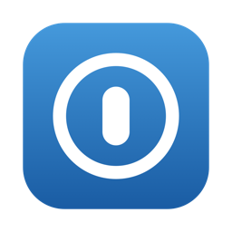
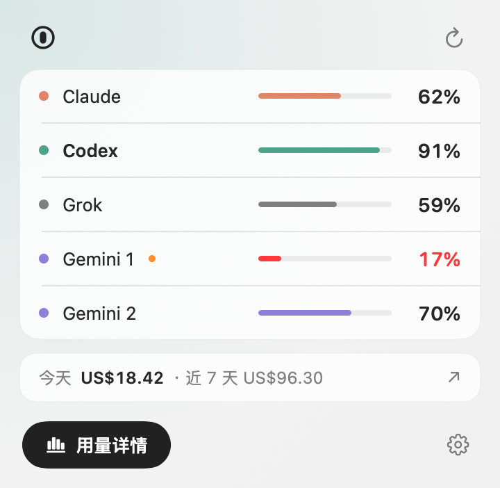
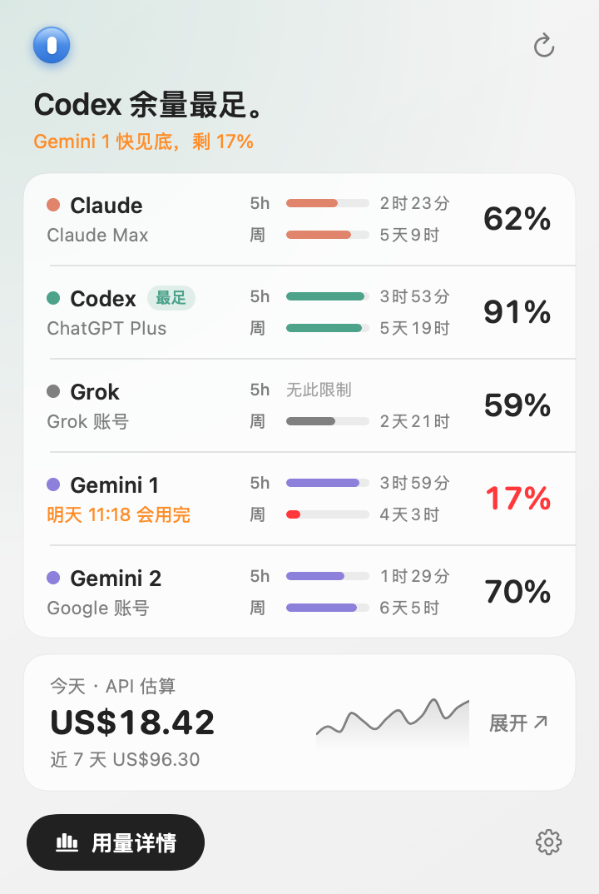
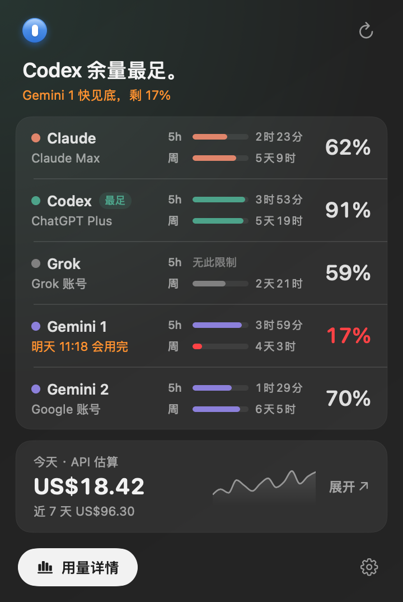

<div align="center">



# T3 用量栏

在 macOS 菜单栏一眼看清 Claude、Codex、Grok、Gemini 还剩多少额度

简体中文 | [English](#english)


 &nbsp; 

</div>

用 [T3 Code](https://t3.codes) 同时开好几家 AI 编程订阅时，最常问自己的一句话是：**现在该用哪家？** T3 用量栏读 T3 Code 已经算好的额度，在菜单栏直接告诉你答案。

## 功能

- **一句话结论**：顶上直接写「Codex 余量最足。」，快见底、会提前用完的另起一行提醒。
- **能用余量**：每家都有 5 小时和 1 周两个限制，哪个先到就卡在哪个，所以大数字取两者里小的那个。
- **用完预测**：按目前的使用速度算，会在重置前用完的，直接写出「明天 10:51 会用完」。
- **两种样式**：点左上角的图标就换（极简是线框图标，正常是立体图标），顶栏不动，下面的内容先收上去、再拉下来。简模式每家只占一行；常模式加上结论句、两个窗口、倒计时和套餐名。
- **拖动排序**：面板里每一行都能直接拖动换位置，松手后一直记住。
- **花费 / Token**：今天、近 7 天的花费（按 API 价估算，美元或人民币），也可以切成用了多少 token；附 14 天走势，点开有按模型、按天的明细窗口。
- **菜单栏四种显示**：仅图标 / 最低余量 / 每家都显示 / 今日花费。
- **快见底通知**：任一窗口低于 20% 时提醒一次，每个重置周期只提醒一次。
- **管理页**：拖动排序、按家显示或隐藏、隐藏个人信息（截图用）、剩余或已用、美元 / 人民币 / Token、刷新间隔、开机启动。
- **动效**：打开时进度条依次涨起、数字滚动、刷新按钮转一圈；系统打开「减少动态效果」时全部关闭。
- 浅色、深色都适配。



## 安装

1. 到 [Releases](../../releases) 下载最新的 `T3UsageBar-x.y.z.zip`，解压后把 `T3UsageBar.app` 拖进「应用程序」。
2. **第一次打开**：这个 app 没有 Apple 开发者签名，macOS 会提示「无法验证开发者」。右键点 app → 选「打开」→ 再点「打开」。
   还是打不开的话，去「系统设置 → 隐私与安全性」，页面下方点「仍要打开」；或者在终端运行：

   ```bash
   xattr -dr com.apple.quarantine /Applications/T3UsageBar.app
   ```

3. 菜单栏出现一个圆形图标就是它。想开机自动启动，在面板右下角齿轮 → 「其他」里打开。

## 运行要求

- macOS 14 或更高，Intel 和 Apple 芯片都支持。
- 已安装 [T3 Code](https://t3.codes) 并登录了要看的订阅。额度和花费都来自 T3 Code 在本机的缓存，T3 Code 没开过的话面板会显示「还没读到余量」。
- 数据太旧时（面板顶上会变橙），点刷新按钮，会在后台打开 T3 Code 让它更新。

## 隐私

- 只读本机的 `~/.t3/caches/*.json` 和 `~/.t3/userdata/` 里的用量缓存。
- **不联网**，不读也不保存任何密码、token、cookie。
- 你的设置只存在本机（`UserDefaults`）。

## 从源码编译

整个 app 是一个 Swift 文件 `Sources/UsageBar.swift`，不需要 Xcode 工程，装了 Command Line Tools 就能编：

```bash
./scripts/build.sh
```

产物在 `dist/`：通用版 zip 和它的 sha256。如果报 SDK 和编译器版本不匹配，用 `SDK=/Library/Developer/CommandLineTools/SDKs/MacOSX26.5.sdk ./scripts/build.sh` 指定一个匹配的 SDK。

开发时有两个参数：`--demo` 用演示数据（README 截图就是这么出的），`--snapshot 目录` 把面板渲染成 PNG 存到目录后退出。

## 说明

- 这是个人做的小工具，和 T3 Code、Anthropic、OpenAI、xAI、Google 都没有关系。
- 读的是 T3 Code 没有公开文档的缓存格式，T3 Code 升级后可能需要跟着改。
- 面板设计参考了 [Cindy](https://cindy.app) 的托盘面板和 [CodexBar](https://github.com/steipete/CodexBar)。

欢迎在 [Issues](../../issues) 提问题和建议。

## 许可证

[MIT](LICENSE)

---

<a id="english"></a>

## English

**T3 用量栏 (T3UsageBar)** is a tiny macOS menu bar app that shows how much quota you have left on Claude, Codex, Grok and Gemini, using the numbers [T3 Code](https://t3.codes) already caches on your Mac.

- One-line verdict at the top ("Codex has the most left"), usable quota = the smaller of the 5-hour and weekly windows, and a "will run out at …" forecast based on your current pace.
- Minimal and full layouts, today / 7-day API-cost estimate with a sparkline, four menu bar modes, low-quota notifications, drag any row to reorder (remembered), light & dark mode.
- Offline and local-only: reads `~/.t3` caches, never touches credentials.

**Install:** download the zip from [Releases](../../releases), move the app to Applications, then right-click → Open the first time (the app is ad-hoc signed, not notarized). Requires macOS 14+ (Intel or Apple silicon) and T3 Code. UI is in Chinese.

**Build:** `./scripts/build.sh` → `dist/T3UsageBar-x.y.z.zip`. MIT licensed. Not affiliated with T3 Code or any model provider.
